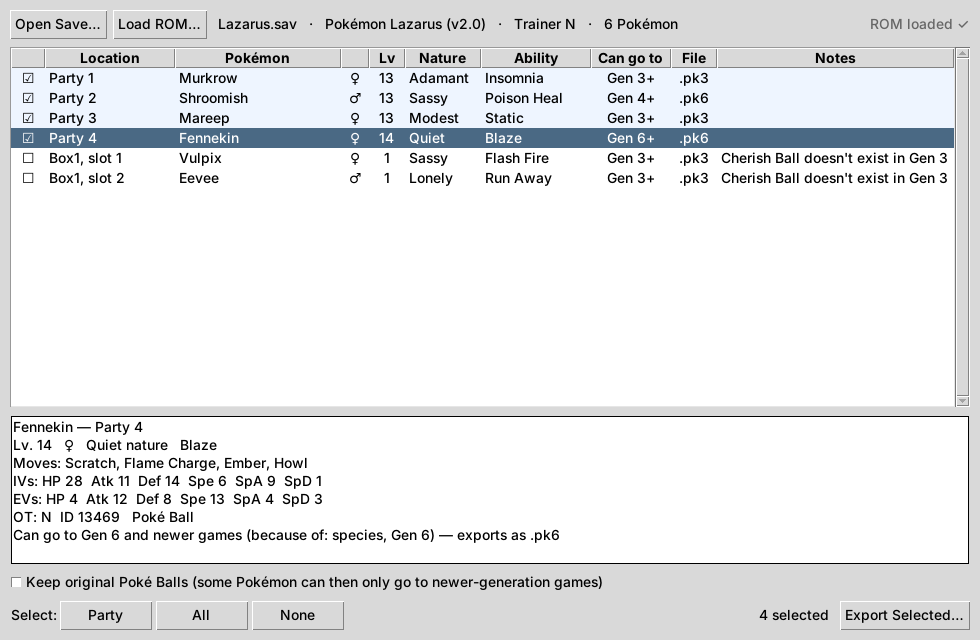

# Pokémon Hack Porter

**Export Pokémon from ROM hack saves as standard Pokémon files.**

Open a save from a supported ROM hack, tick the Pokémon you want from your party and PC boxes, and export them as `.pk3`, `.pk6`, `.pk7`, `.pk8` or `.pk9` files. Your save file is only read, never changed.

> **AI disclaimer:** This program, including its code and this description, was made entirely with AI (Anthropic's Claude, with help from xAI's Grok). It has been tested on real save files, but it may contain mistakes. Back up your saves, and please report anything that looks wrong.

---

## Supported ROM hacks

| ROM hack | Testing | Party | PC boxes | Notes |
|---|---|---|---|---|
| Pokémon Lazarus (v2.0) | **Extensive** | ✅ | ✅ | Check genders marked **?** against the game |
| Pokémon Emerald Imperium (v1.3) | Light | ✅ | ✅ | |
| Pokémon Unbound (v2.1) | Light | ✅ | ✅ | |
| Pokémon Odyssey (v4.1) | Light | ✅ | ✅ | |
| Pokémon Gaia (v3.2) | Light | ✅ | ✅ | Poké Balls are exported as regular Poké Balls |
| Pokémon Light Platinum | Light | ✅ | ✅ | Load the hack's ROM to identify every Pokémon |

**Lazarus has had extensive testing:** saves from different points in my playthrough, with the Pokémon checked against their in-game summary screens, and automatic re-checks against those screens after every update. **The other hacks have only had a little testing:** I played long enough to catch a few Pokémon for the party and PC boxes, then checked that the program read them correctly. Things that only appear later in a game — rare forms, late-game moves, special events — haven't been checked. Other versions of these hacks may work but haven't been tested.

## Help expand and test it

Want your favourite ROM hack supported, or more testing on the ones above? **[Send me your save file](../../issues/new/choose)** — the form asks for the hack name and version, what's in your party and boxes, and the zipped `.sav`. Save files are all that's needed to add a new hack. Please never send ROMs.

## Download

Get the version for your system from the **[Releases](../../releases)** page — no Python needed:

- **Windows:** unzip and run `Pokemon-Hack-Porter.exe`
- **Linux / Steam Deck:** extract and run `Pokemon-Hack-Porter`
- **macOS:** unzip and open `Pokemon Hack Porter.app`

The app isn't signed, so Windows or macOS may warn you the first time. On Windows click **More info → Run anyway**; on macOS right-click the app → **Open**.

You can also run `pokemon_hack_porter.py` directly with Python 3.8+.

## How to use

1. Click **Open Save…** and pick your `.sav` file.
2. Tick the Pokémon you want (party Pokémon are ticked automatically). Click a row to see its details.
3. Check each Pokémon's gender (♂/♀) and level (Lv) against its summary screen in the game, especially genders marked **?**. If one doesn't match, click it to change it (see below).
4. Click **Export Selected…** and choose a folder.

**Why a gender or level might not match:** hacks can change a Pokémon's gender odds and how fast it levels up, and the save file alone doesn't say which. Without that information the program uses the official games' rules, so a Pokémon can come out as the other gender or, if it's in a box, a level lower. For hacks known to change gender odds (like Lazarus), genders the program can't confirm are marked **?**; changes already confirmed (like Lazarus's Fennekin line) are applied automatically. Click the ♂/♀ to flip it, or the level to type the one the game shows; changed values get a `*`. For `.pk3` files, the program adjusts the Pokémon's personality value to match the gender, keeping its nature and shininess.

**Load ROM… (optional):** for some hacks, the program can read the gender odds and level-up speeds from the hack's `.gba` file and fix these automatically. If the data it finds doesn't look right, it ignores it and tells you. For Light Platinum, the ROM is also needed to identify Pokémon. The ROM is only read, never changed.

- **Can go to** shows the oldest game generation each Pokémon can be moved into (e.g. *Gen 4+*).
- **Keep original Poké Balls:** by default, a ball that doesn't exist in older games is swapped for a Poké Ball. Tick this to keep the original ball instead.
- **Odyssey and Gaia** saves look alike, so the program asks which game the save is from.

## Importing the files

The exported files work with any tool that reads standard Pokémon files, including:

- **[OpenHome](https://github.com/andrewbenington/OpenHome)**
- **[PKVault](https://github.com/Chnapy/PKVault)**
- **[PKHeX](https://github.com/kwsch/PKHeX)**
- **PKSM** (3DS homebrew, `.pk3`–`.pk7` only)

From these, Pokémon can be moved into official games.

## What carries over

Species, nickname, Original Trainer, nature, gender, shininess, IVs, EVs, level, moves, friendship, Poké Ball and ability slot are kept.

- **Held items** are dropped, and the met location becomes "traded".
- **Abilities:** hacks often change abilities, so Pokémon get the official ability for the same slot.
- **Gen 8 and 9 Pokémon** (and Galarian, Hisuian and Paldean forms) become `.pk8` files for Sword/Shield, or `.pk9` files for Scarlet/Violet if they're only in that game. Moves the game doesn't have are dropped.
- **Hack-only Pokémon and forms**, Pokémon that are in neither Sword/Shield nor Scarlet/Violet, and **eggs** can't be exported.

## ⚠️ Legality

ROM hack Pokémon will **never pass legality checks**. They're fine for single-player, but **don't** use them online or put them into **Pokémon Home** or **Pokémon Bank**.

## Troubleshooting

- **"Couldn't find an intact save"** — save from the in-game menu; emulator save states don't update the `.sav` file.
- **Wrong species or ability, or your hack isn't supported** — fill in the **[save file form](../../issues/new/choose)**.

## Credits & license

Data and formats from **[PKHeX](https://github.com/kwsch/PKHeX)** (GPL-3.0), **[OpenHome](https://github.com/andrewbenington/OpenHome)** (GPL-3.0) and **[pokeemerald-expansion](https://github.com/rh-hideout/pokeemerald-expansion)** by Rom Hacking Hideout. Thanks to the creators of the supported ROM hacks.

Released under the **GNU General Public License v3.0** — see [LICENSE](LICENSE).

Pokémon is © Nintendo, Game Freak and The Pokémon Company. This project is not affiliated with them and does not include or distribute any ROMs.
